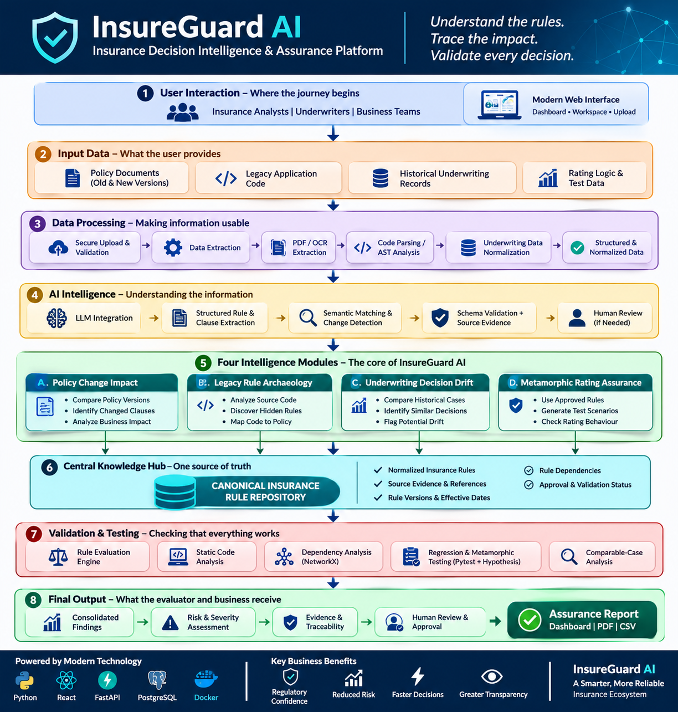
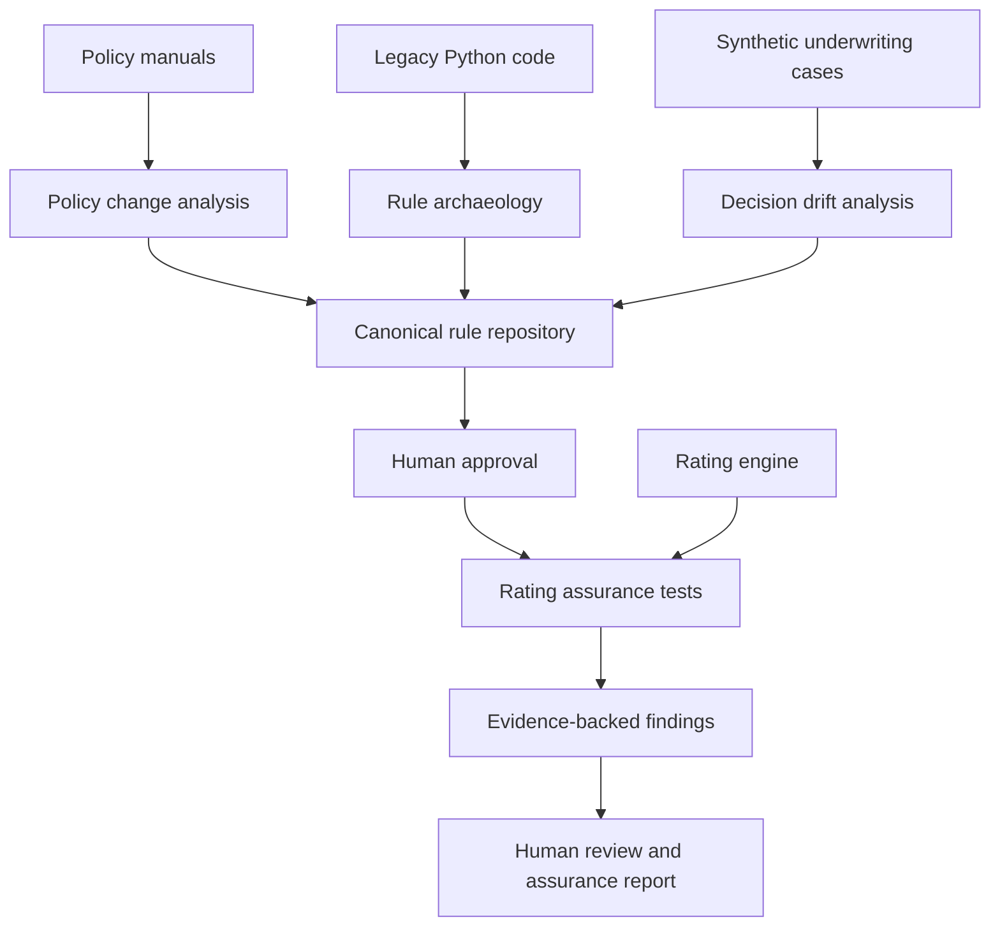

<div align="center">

# InsureGuard AI
### Insurance Decision Intelligence & Assurance Platform

**Understand the rules. Trace the impact. Validate every decision.**

[](https://www.python.org/)
[](https://fastapi.tiangolo.com/)
[](https://pytest.org/)
[](#project-status-and-scope)

*A prototype for tracing insurance policy changes into implemented rating logic, underwriting outcomes and reproducible assurance tests.*

</div>

---

## At a glance

InsureGuard AI brings four connected insurance-analysis capabilities into one workflow. It compares policy manuals, investigates legacy Python rating code, highlights potentially inconsistent underwriting decisions and tests rating behaviour against approved rules.

The prototype uses a **shared canonical rule repository** to connect extracted rules, source references, dependencies, approval status and test evidence.

> **Important:** This repository is a research/demo prototype using synthetic insurance data. It is not a production underwriting system, legal/compliance opinion, or a replacement for qualified human review.

## Architecture



The workflow is designed to move from source material to evidence-backed findings:

1. **User interaction** — an analyst opens the dashboard and starts an analysis.
2. **Input data** — policy manuals, legacy Python code, synthetic underwriting records and rating engines.
3. **Data processing** — secure local file handling, PDF/text extraction, AST parsing and case normalization.
4. **Rule understanding** — deterministic extraction and matching, with source/evidence checks.
5. **Four intelligence modules** — policy impact, rule archaeology, underwriting drift and rating assurance.
6. **Canonical rule repository** — a shared record of normalized rules, references, versions, dependencies and approval status.
7. **Validation** — rule checks, static analysis, dependency analysis and property-based/regression tests.
8. **Assurance output** — findings, severity, traceability, human review and a consolidated report.

## The four modules

| Module | Purpose | Main implementation |
|---|---|---|
| **A. Policy Change Impact** | Compares two rate manuals, extracts candidate rules and identifies affected dependencies. | `app/policy.py`, `app/impact.py` |
| **B. Legacy Rule Archaeology** | Uses Python AST analysis to locate implemented rating rules and compare code with manual expectations. | `app/archaeology.py` |
| **C. Underwriting Decision Drift** | Groups comparable synthetic cases and flags differing decisions without a recorded reason. | `app/drift.py` |
| **D. Metamorphic Rating Assurance** | Tests rating engines against approved rules using property-based, boundary, differential and metamorphic checks. | `app/assurance.py`, `app/sandbox.py` |

### How the modules work together



## Screenshots
## Screenshots

Explore the complete application:

[View Application Screenshots](SCREENSHOTS.md)
Application screenshots belong in [`assets/screenshots/`](assets/screenshots/). Add your captured dashboard images there and link them below. The architecture infographic above is included already.

<!-- Replace the placeholder below after adding your screenshot file. -->
<!--  -->

## Technology stack

- **Backend:** Python, FastAPI, Uvicorn
- **Frontend:** HTML, CSS and vanilla JavaScript
- **Data:** SQLite and CSV-based synthetic cases
- **Document processing:** PyMuPDF
- **Code analysis:** Python `ast`
- **Testing:** Pytest and Hypothesis
- **Graph analysis:** NetworkX
- **Reporting:** HTML and PDF/report utilities

## Quick start

### Requirements

- Python 3.10 or newer (Python 3.11 is a good default)
- macOS, Linux or Windows
- Git (for cloning)

### 1. Clone the repository

```bash
git clone https://github.com/<YOUR-GITHUB-USERNAME>/insureguard-ai.git
cd insureguard-ai
```

### 2. Create and activate a virtual environment

**macOS / Linux**

```bash
python3 -m venv .venv
source .venv/bin/activate
```

**Windows PowerShell**

```powershell
py -m venv .venv
.venv\Scripts\Activate.ps1
```

### 3. Install dependencies

```bash
python -m pip install --upgrade pip
python -m pip install -r requirements.txt
```

### 4. Generate the synthetic cases (optional)

The repository includes a generated sample dataset. To regenerate it:

```bash
python data/generate_cases.py
```

### 5. Start the application

```bash
python -m uvicorn app.main:app --reload --port 8000
```

Open:

- Dashboard: <http://127.0.0.1:8000/>
- Interactive API docs: <http://127.0.0.1:8000/docs>
- Health check: <http://127.0.0.1:8000/api/health>

Keep the terminal running while using the dashboard. Stop the server with `Ctrl+C`.

## Run a demonstration

1. Open the dashboard at `http://127.0.0.1:8000/`.
2. Choose the `analyst` role.
3. Select `rating_v2 (seeded defects)` in the engine selector.
4. Click **Run full pipeline**.
5. Explore **Overview**, **Policy impact**, **Rule archaeology**, **Underwriting drift**, **Rating assurance**, **Rules & approvals**, **Dependency graph**, **Findings** and **Audit**.
6. Switch to `rating_v2_clean (control)` and rerun to compare the clean engine with the intentionally defective engine.
7. For the approval workflow, disable auto-approval, switch to the `reviewer` role, run the pipeline and review candidate rules before rerunning assurance.

The role selector is a demo mechanism, not production authentication. Use only the bundled synthetic data for demonstrations.

## Tests and evaluation

Run the automated test suite:

```bash
python -m pytest
```

Run the seeded-defect evaluation:

```bash
python scripts/evaluate.py
```

The checked-in evaluation scenario uses synthetic data and deliberately planted defects. The project README originally records these expected demonstration outcomes:

| Evaluation | Recorded scenario result |
|---|---:|
| Planted rating defects found by property tests | 2 / 2 |
| Planted rating defects found by static analysis | 2 / 2 |
| False positives on the clean engine (property failures / static rate or boundary findings) | 0 / 0 |
| Planted unexplained underwriting rejections flagged | 3 / 3 |
| Explained rejection incorrectly flagged | No |

These are controlled-scenario results, **not** performance claims for real insurer data. Re-run the evaluation in your environment before relying on them.

## API overview

| Method | Endpoint | Purpose |
|---|---|---|
| `GET` | `/api/health` | Health check |
| `POST` | `/api/pipeline/run` | Run the integrated pipeline |
| `GET` | `/api/rules` | Retrieve rules |
| `POST` | `/api/rules/{id}/decision` | Review a candidate rule |
| `GET` | `/api/policy/changes` | Retrieve policy changes |
| `GET` | `/api/impact` | Retrieve impact analysis |
| `GET` | `/api/graph` | Retrieve dependency graph |
| `POST` | `/api/archaeology/run` | Run code archaeology |
| `POST` | `/api/drift/run` | Run underwriting drift analysis |
| `POST` | `/api/assurance/run` | Run rating assurance |
| `GET` | `/api/findings` | Retrieve findings |
| `POST` | `/api/findings/{id}/review` | Review a finding |
| `GET` | `/api/report` | Retrieve report data |
| `GET` | `/api/report.html` | View HTML report |
| `GET` | `/api/audit` | Retrieve audit events |

Role-based endpoint checks use the `X-Role` header (`viewer`, `analyst`, `reviewer`, `admin`). This is not a secure identity/authentication system.

## Project structure

```text
insureguard-ai/
├── app/                 # FastAPI application and analysis modules
├── assets/              # Architecture infographic and screenshots
│   └── screenshots/
├── data/                # Synthetic manuals, cases and evaluation output
│   └── manuals/
├── docs/                # Additional project documentation
├── engines/             # Legacy, seeded-defect and clean rating engines
├── scripts/             # Data generation and evaluation utilities
├── static/              # Browser dashboard
├── tests/               # Automated tests
├── .gitignore
├── CONTRIBUTING.md
├── requirements.txt
└── README.md
```

## Project status and scope

This is a working prototype with a deliberately bounded scope. The current implementation differs from a future enterprise architecture in several important ways:

- The dashboard is **HTML/CSS/vanilla JavaScript**, not React.
- Persistence uses **SQLite**, not PostgreSQL.
- Rule extraction is based on deterministic patterns tailored to the included manual format; **no LLM is integrated**.
- Legacy-code analysis currently targets supported Python rating-code patterns; it does not parse Java or COBOL.
- The role header is a demonstration access-control mechanism, not real authentication.
- Rating execution uses a separate process with resource limits; it is **not a hardened container sandbox** and does not provide full network/filesystem isolation.
- Underwriting drift uses fixed comparability bands and synthetic records.

These boundaries are intentional to keep the prototype reproducible and explainable. Production deployment would require security hardening, stronger identity and access management, broader document/code support, operational monitoring, privacy controls, and validation with authorized real-world datasets.

## Responsible use

- Do not upload confidential policyholder, customer or insurer data to this demo.
- Findings are indicators for investigation, not automatic conclusions about fairness, misconduct or compliance.
- Preserve human review for business-rule approval and consequential decisions.
- Treat uploaded code and documents as untrusted input.

## Contributing

See [CONTRIBUTING.md](CONTRIBUTING.md) for local development and pull-request guidance. Please open an issue before proposing major architectural changes.

## License

No license has been selected for this repository yet. Before making it public, choose and add a license if you want to grant others permission to reuse, modify or distribute the code. Without a license, default copyright restrictions apply.

---

<div align="center">

**InsureGuard AI** · A prototype for more traceable, testable insurance decisions.

</div>
