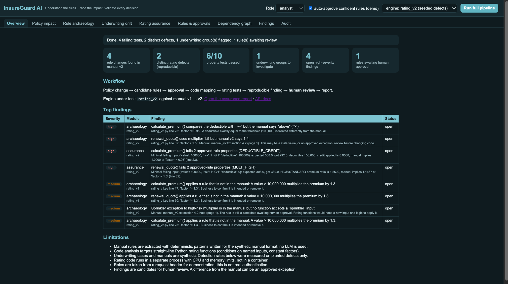
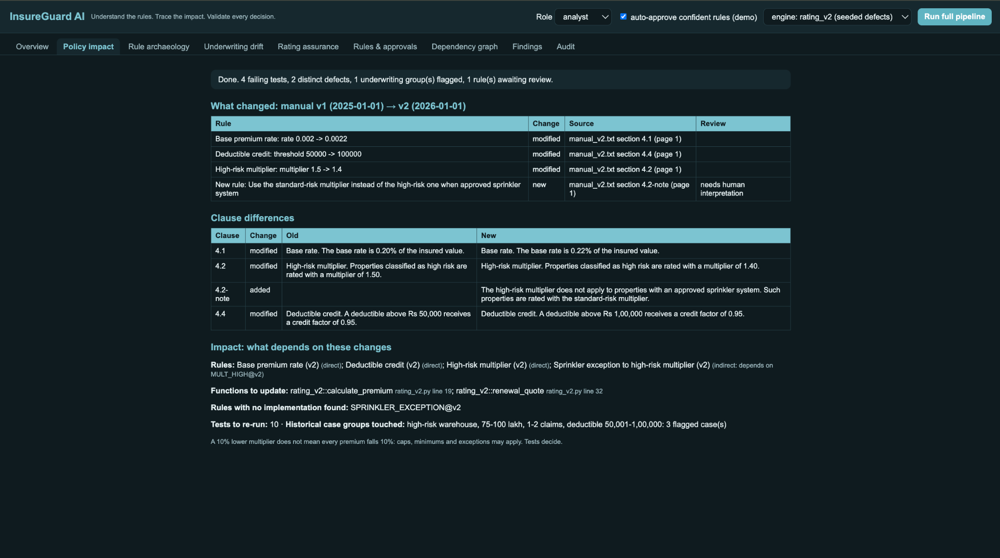
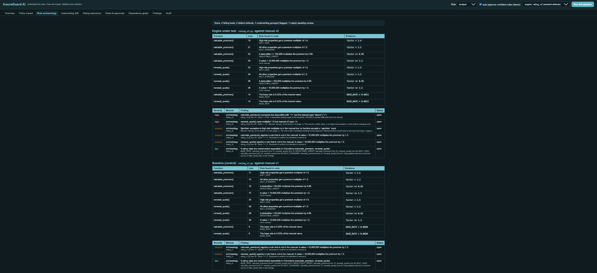
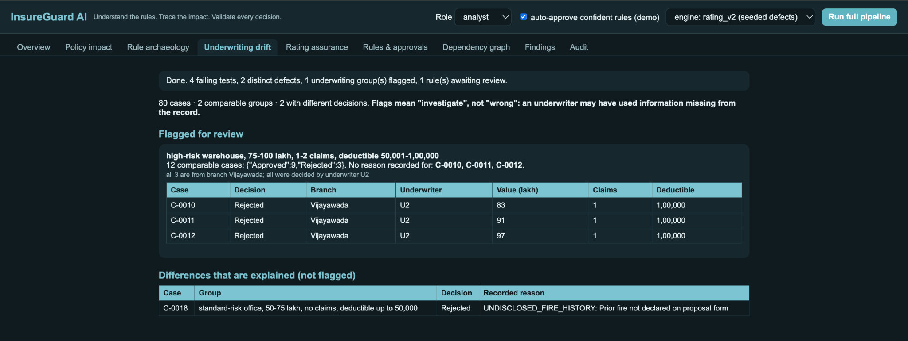
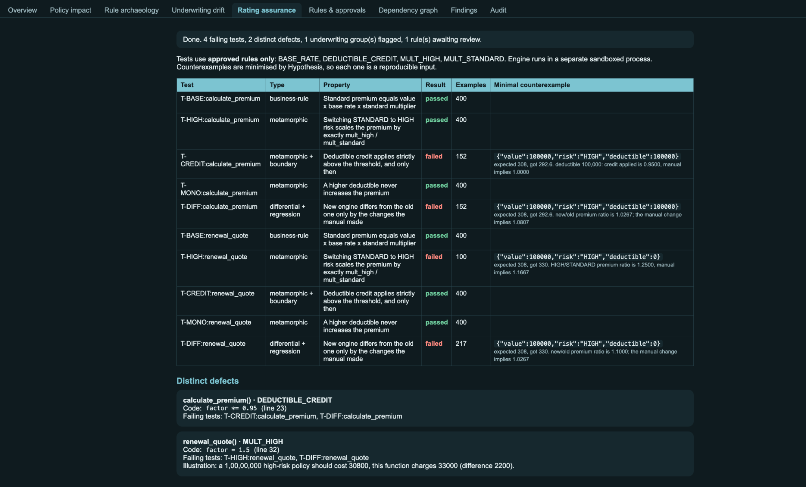
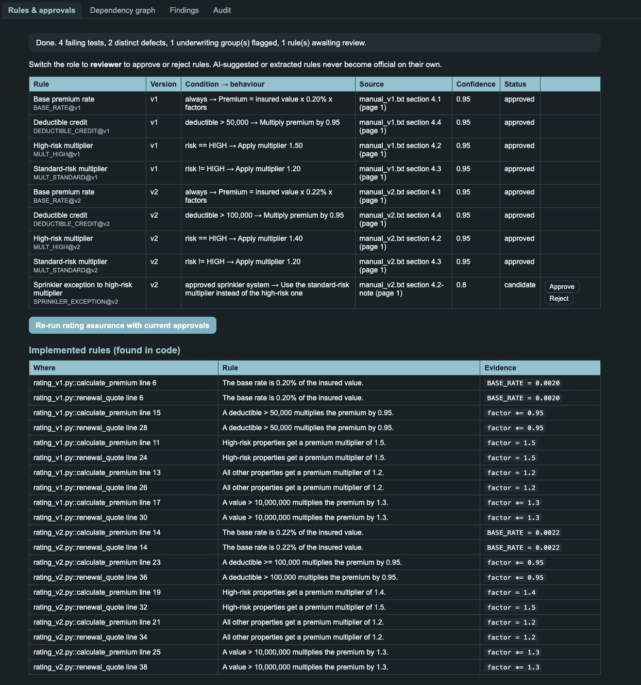
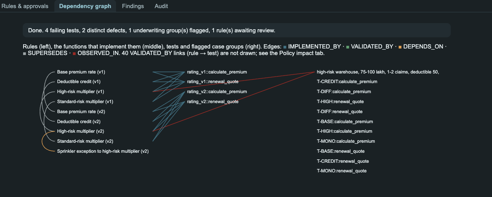
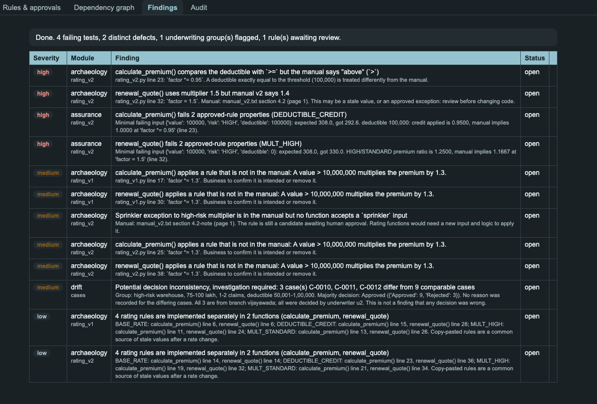
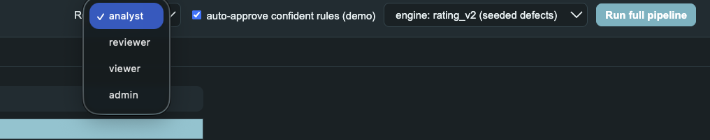

# InsureGuard AI — Screenshot Gallery

These screenshots show the current InsureGuard AI prototype after running the sample pipeline.

## Application overview



## Policy change impact

Compares the two sample policy-manual versions and highlights changed clauses, source references, and downstream impact.



## Legacy rule archaeology

Shows business rules discovered in the sample Python rating implementation, with function and line-level evidence.



## Underwriting decision drift

Highlights comparable synthetic cases with different recorded decisions. A flag means investigate; it does not establish that a decision was wrong.



## Metamorphic rating assurance

Displays property-based and differential test results, including reproducible counterexamples for seeded defects.



## Rules and human approvals

Shows rule versions, source references, confidence, approval status, and the reviewer actions available for candidate rules.



## Dependency graph

Visualizes relationships between rules, implementation functions, tests, and flagged case groups.



## Findings

Consolidates findings with severity, module, evidence, and review status.



## Role selector

The prototype's demonstration role selector.



---

## Add this folder to the project

Copy the `screenshots/` directory into the root of your InsureGuard AI repository.

Then add a link to this gallery from the main `README.md`:

```markdown
## Screenshots

See the [complete application screenshot gallery](SCREENSHOTS.md).
```

If you rename this file to `SCREENSHOTS.md` in your repository root, the relative image paths will work as written.
